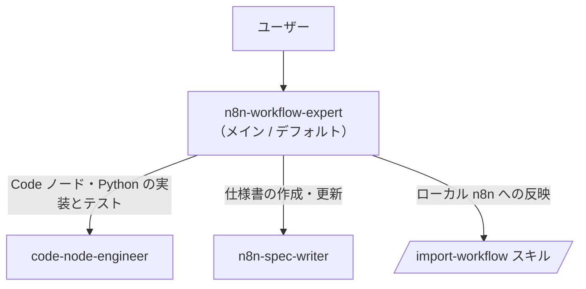

# Claude Code の使い方

このリポジトリには、チームで共有する Claude Code の設定（`.claude/`）が含まれています。リポジトリで `claude` を起動するだけで有効になります。

## エージェント構成



| エージェント | 役割 | 主な対象 | 使えるツール |
| --- | --- | --- | --- |
| `n8n-workflow-expert` | ワークフローの設計、JSON の作成と検証、他のエージェントへの依頼。`settings.json` の `agent` でデフォルトに指定 | `workflows/` | すべて |
| `code-node-engineer` | Code ノードの JS と Python 処理の実装、Jest / pytest のテスト作成 | `src/`、`tests/` | Read / Write / Edit / Glob / Grep / Bash |
| `n8n-spec-writer` | 変更されたワークフローや処理を読み取り、仕様書を作成・更新する（コードは変更しない） | `doc/specifications/` | Read / Write / Edit / Glob / Grep / Bash |

定義ファイルは `.claude/agents/*.md` です。

### 仕様書の自動更新の流れ
1. `workflows/*.json`、`src/javascript/code-nodes/`、`src/python/` のファイルが編集される
2. `spec-reminder.js` フックが「仕様書の更新が必要」と Claude に通知する
3. メインエージェントが作業の区切りで `n8n-spec-writer` に依頼する
4. `n8n-spec-writer` は `git status` / `git diff` と `describe-workflow.js` で変更点を把握し、`doc/specifications/<name>.md` を作成・更新する（変更履歴に 1 行追加）

明示的に呼ぶ場合の例:

```
n8n-spec-writer で doc/specifications を最新化して
contacts-intake の仕様書を作り直して
```

## スキル

| スキル | 呼び出し方 | 内容 |
| --- | --- | --- |
| `import-workflow` | `/import-workflow [workflows/xxx.json]`、または「n8n に反映して」 | コンテナの起動確認 → Code ノードの同期 → 検証 → `n8n import:workflow` → URL の案内 |

## フック（`.claude/settings.json` の `hooks.PostToolUse`）

| フック | タイミング | 内容 |
| --- | --- | --- |
| `format-on-edit.js` | Write / Edit / MultiEdit の直後 | JS/TS は Prettier、Python は Ruff（`check --fix` と `format`）で整形する。エラーがあれば Claude に返して修正させる |
| `spec-reminder.js` | 同上 | ワークフローやロジックのファイルが変わったら、仕様書の更新を促す |

フォーマッタが未インストールの場合は警告だけ出してスキップします。`npm install` と `.venv` の作成を先に済ませてください。

## 権限（`permissions`）

| 種類 | 対象 |
| --- | --- |
| allow（確認なしで実行） | テスト、フォーマット、ワークフロー検証、同期、`describe`、`git status` / `git diff`、`docker compose ps` / `logs` / `config` |
| ask（毎回確認） | n8n へのインポート・エクスポート、`docker compose down` |
| deny（禁止） | `.env` と `.env.*` の読み取り、`docker compose down -v`、`docker volume rm` |

個人だけで使う設定は `.claude/settings.local.json`（Git の管理対象外）に書いてください。

## 依頼の例

```
受信した注文 Webhook を Slack に通知するワークフローを workflows/order-notify.json に作って。
金額が 10 万円以上なら #sales-alert、それ以外は #sales に振り分けて。
```

→ `n8n-workflow-expert` が JSON を設計し、振り分けの Code ノードを `code-node-engineer` に依頼し、最後に `n8n-spec-writer` が `doc/specifications/order-notify.md` を作成します。
