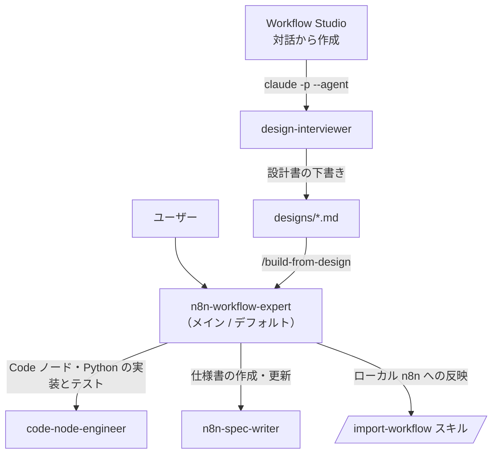

# Claude Code の使い方

このリポジトリには、チームで共有する Claude Code の設定（`.claude/`）が含まれています。リポジトリで `claude` を起動するだけで有効になります。

## エージェント構成



| エージェント | 役割 | 主な対象 | 使えるツール |
| --- | --- | --- | --- |
| `n8n-workflow-expert` | ワークフローの設計、JSON の作成と検証、他のエージェントへの依頼。`settings.json` の `agent` でデフォルトに指定 | `workflows/` | すべて |
| `code-node-engineer` | Code ノードの JS と Python 処理の実装、Jest / pytest のテスト作成 | `src/`、`tests/` | Read / Write / Edit / Glob / Grep / Bash |
| `n8n-spec-writer` | 変更されたワークフローや処理を読み取り、仕様書を作成・更新する（コードは変更しない） | `doc/specifications/` | Read / Write / Edit / Glob / Grep / Bash |
| `design-interviewer` | ラフなアイデアを聞き取り、設計書の下書きを返す。Workflow Studio の「対話から作成」が `claude -p --agent design-interviewer` で使う（ファイルは書かない） | `designs/`（読み取りのみ） | Read / Glob / Grep / n8n MCP のノード参照 |

定義ファイルは `.claude/agents/*.md` です。

### 仕様書の自動更新の流れ
1. `workflows/*.json`、`src/javascript/code-nodes/`、`src/python/` のファイルが編集される
2. `spec-reminder.js` フックが「仕様書の更新が必要」と Claude に通知する
3. メインエージェントが作業の区切りで `n8n-spec-writer` に依頼する
4. `n8n-spec-writer` は `git status` / `git diff` と `describe-workflow.js` で変更点を把握し、`doc/specifications/<name>.md` を作成・更新する（変更履歴に 1 行追加）

明示的に呼ぶ場合の例:

```
n8n-spec-writer で doc/specifications を最新化して
contacts-intake の仕様書を作り直して
```

## スキル

| スキル | 呼び出し方 | 内容 |
| --- | --- | --- |
| `build-from-design` | `/build-from-design designs/xxx.md`、または「この設計書から作って」 | 設計書の確認 → 認証情報の確認 → Code 実装とテスト → MCP でノード定義を照合・検証して JSON 構築 → テストデプロイ（HTTP ケース + MCP ケース）→ 仕様書作成（[design-driven-development.md](design-driven-development.md)） |
| `import-workflow` | `/import-workflow [workflows/xxx.json]`、または「n8n に反映して」 | コンテナの起動確認 → Code ノードの同期 → Credential 投入 → 検証 → `n8n import:workflow` → MCP で取り込みを確認 → URL の案内 |

## n8n MCP サーバー（`.mcp.json`）

ローカル n8n の MCP サーバー（`http://localhost:5678/mcp-server/http`）を Claude Code に登録しています。
Claude は推測でノードのパラメータを書かずに、n8n から正しい定義を取り出して検証してから JSON を書きます。
また、Webhook 以外のトリガー（Form など）を持つワークフローもテストで実行できます。

### 費用について
このプロジェクトは、**n8n の無料版（セルフホストの Community Edition）と Claude Code のサブスクリプションの範囲で完結する** ことを前提にしています。

| 仕組み | 費用 | 使い方 |
| --- | --- | --- |
| n8n の Instance-level MCP | 無料版で使える | 使う（ノード定義の取得・検証、テスト実行） |
| Claude Code（対話・`claude -p`） | サブスクリプションの範囲 | 使う（構築・テスト・仕様書） |
| n8n Public API（`N8N_API_KEY`） | 無料版で使える | 使う（Webhook のテストデプロイで公開・非公開を切り替える） |
| n8n の AI Workflow Builder | クレジット制・プラン依存 | **使わない** |

### 初回の接続（1 回だけ）
1. `npm run n8n:up` で n8n を起動し、http://localhost:5678 の **Settings → Instance-level MCP** で **Enable MCP access** をオンにする
2. リポジトリで Claude Code を起動する（VS Code では新しいセッションを開く）。「プロジェクトの MCP サーバー n8n を使うか」と聞かれたら許可する
3. `/mcp` → `n8n` → **Authenticate**。ブラウザで n8n にログインしてアクセスを許可する（OAuth。トークンをファイルに保存する必要はない）
4. `/mcp` で `n8n` が connected になっていれば完了

### Claude が使うツール

| 場面 | ツール | 権限 |
| --- | --- | --- |
| ノード選定・定義の取得 | `search_nodes`、`get_node_types`、`get_workflow_best_practices` | 確認なし |
| ノード単位の検証 | `validate_node_config` | 確認なし |
| 実際の値の取得 | `explore_node_resources`、`list_credentials`（値は返らない） | 確認なし |
| ワークフロー・実行結果の参照 | `search_workflows`、`get_workflow_details`、`get_workflow_execution`、`search_workflow_executions` | 確認なし |
| テスト実行 | `execute_workflow`（`executionMode: "manual"`） | 確認なし |
| n8n 上のワークフローの作成・変更・公開・アーカイブ | `create_workflow_from_code`、`update_workflow`、`publish_workflow` など | 毎回確認（基本は使わない） |

> 「確認なし」のツールは、どれも読み取りか検証だけで n8n 側を変更しないため、`.claude/settings.json` の `permissions.allow` に登録しています。
> `npm run design:build -- <file> --auto` では、`scripts/lib/claude-cli.js` の `AUTO_ALLOWED_TOOLS` でこれらと `execute_workflow` を許可しています。

### ルール
- ワークフローの正は `workflows/*.json`。n8n への反映は `npm run n8n:import` で行い、MCP で n8n 上のワークフローを直接変更しない
  （例外: ノードの出力形式を確かめる一時的な検証用ワークフロー。確認後にアーカイブする）
- CLI でインポートしたワークフローを MCP から見えるようにするため、JSON の `settings` に `"availableInMCP": true` を付ける（`validate:workflows` で必須）
- MCP が使えない場合、Claude は MCP を使わない従来の手順で作業し、その旨を報告する

## フック（`.claude/settings.json` の `hooks.PostToolUse`）

| フック | タイミング | 内容 |
| --- | --- | --- |
| `format-on-edit.js` | Write / Edit / MultiEdit の直後 | JS/TS は Prettier、Python は Ruff（`check --fix` と `format`）で整形する。エラーがあれば Claude に返して修正させる |
| `spec-reminder.js` | 同上 | ワークフローやロジックのファイルが変わったら、仕様書の更新を促す |

フォーマッタが未インストールの場合は警告だけ出してスキップします。`npm install` と `.venv` の作成を先に済ませてください。

## 権限（`permissions`）

| 種類 | 対象 |
| --- | --- |
| allow（確認なしで実行） | テスト、フォーマット、ワークフロー検証、同期、`describe`、`secrets:check`、`git status` / `git diff`、`docker compose ps` / `logs` / `config`、ローカル n8n へのインポート・Credential 投入・テストデプロイ、MCP の参照・検証・テスト実行（`execute_workflow`） |
| ask（毎回確認） | n8n からのエクスポート、`secrets:init`、`docker compose up` / `down`、MCP のワークフロー変更系ツール（作成・更新・公開・アーカイブ） |

> ローカル n8n へのインポート・Credential 投入・テストデプロイを allow にしているのは、Workflow Studio や `design:build --auto` の
> 非対話モード（`claude -p`）では確認画面を出せず、ask のままだと必ず拒否されて構築が取り込みの手前で止まるためです。
> どれもローカルの n8n だけに影響します。構築を始める操作（Studio の「構築を開始」など）を確認とみなしています。
| deny（禁止） | `.env` と `.env.*` の読み取り、`secrets/` の読み書き、値を出力する `secrets.js credentials` の直接実行、`docker compose down -v`、`docker volume rm` |

個人だけで使う設定は `.claude/settings.local.json`（Git の管理対象外）に書いてください。

## 依頼の例

```
受信した注文 Webhook を Slack に通知するワークフローを workflows/order-notify.json に作って。
金額が 10 万円以上なら #sales-alert、それ以外は #sales に振り分けて。
```

→ `n8n-workflow-expert` が JSON を設計し、振り分けの Code ノードを `code-node-engineer` に依頼し、最後に `n8n-spec-writer` が `doc/specifications/order-notify.md` を作成します。
