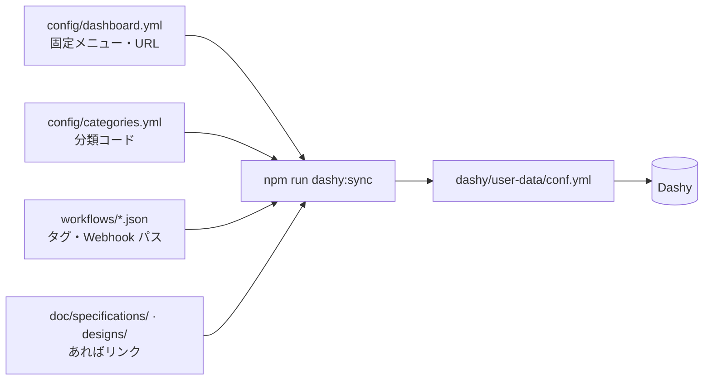

# ダッシュボード（Dashy）と分類コード

作成したワークフロー（アプリ）を、分類ごとに [Dashy](https://dashy.to/) のダッシュボードに一覧表示します。
Dashy の設定ファイル `conf.yml` はリポジトリから自動で生成されるため、手で編集する必要はありません。

- URL: http://localhost:4000（`.env` の `DASHY_PORT` で変更可能）
- 起動: `npm run n8n:up`（n8n・PostgreSQL と一緒に起動します）

## 画面の構成

```
n8n Workflow Portal
├─ アプリ作成・ツール        ← config/dashboard.yml の toolsSection（固定）
│   ├─ アプリ作成  → Workflow Studio（doc/studio.md。起動していないと状態表示が赤になります）
│   ├─ n8n         → ワークフローエディタ
│   ├─ 設計書の書き方
│   └─ GitHub
├─ [SLS] 営業・販売          ← config/categories.yml の順で、ワークフローがある分類だけ表示
│   └─ 注文通知              クリック → n8n の編集画面
├─ [OPS] 社内業務・運用
│   └─ 備品貸出申請          クリック → n8n のフォーム（送信でワークフローが動く）
├─ [SMP] サンプル・検証
│   └─ Contacts Intake
└─ リンク・資料（最初は折りたたみ）  ワークフローごとに次のアイコンを並べる
    └─ 注文通知
         ├ ✏️ n8n で編集
         ├ 📋 POST …/webhook/order-notify をコピー
         ├ 📄 仕様書（GitHub）
         └ 📐 設計書（GitHub）
```

- Form Trigger を持つワークフローは、カードをクリックするとフォーム（`/form/<path>`）が開き、送信するとワークフローが動きます（アプリとして使う形）。n8n の編集画面は「リンク・資料」セクションの「n8n で編集」から開きます。フォームの本番 URL は、n8n でワークフローを公開（有効化）した場合だけ使えます。
- カードのタイトルは Dashy の制限で最大 18 文字です。ワークフロー名の括弧以降は省略され、長い場合は末尾が「…」になります。正式名称は説明（マウスを乗せると表示）に出ます。
- Webhook は POST で呼ぶものが多いため、カードのリンク先は n8n の編集画面にしています。API の URL は、「リンク・資料」セクションのアイコンからクリップボードにコピーできます。
- カードに付随するリンクを別セクションにしているのは、Dashy ではカードにサブ項目（subItems）を付けると、カード自体がリンクでなくなり、アイコンも表示されなくなるためです。

## 分類コード

`config/categories.yml` で管理します。

| コード | 分類 |
| --- | --- |
| SLS | 営業・販売 |
| MKT | マーケティング |
| CS | カスタマーサポート |
| OPS | 社内業務・運用 |
| DATA | データ連携・集計 |
| AI | AI 活用 |
| SMP | サンプル・検証 |

### 付け方
- **ワークフロー JSON**: `tags` に分類コードを **ちょうど 1 つ** 付けます。n8n の画面でもタグとして表示されます。
  ```json
  "tags": [{ "name": "SLS" }]
  ```
- **設計書**: front matter に `category: SLS` と書きます。`/build-from-design` がワークフローのタグに反映します。

`npm run validate:workflows`（CI でも実行）が、分類タグが無い・複数ある・一覧に無いコードを使っている、をエラーにします。
`npm run design:build` も、設計書の `category` が一覧に無ければ Claude を起動せずに止まります。

### 分類を追加・変更する
1. `config/categories.yml` に `code`（英大文字で始まる 2〜5 文字）、`name`、`icon` を追加する
2. `npm run dashy:sync`

コードを変更する場合は、そのコードを使っているワークフローのタグと設計書の `category` も合わせて変更してください（検証で検出されます）。

## 自動登録の仕組み



`dashy:sync` は次のタイミングで自動的に実行されます。

| タイミング | 実行元 |
| --- | --- |
| `npm run n8n:up` | 起動前に生成（Dashy は conf.yml が無いと起動できないため） |
| `npm run n8n:import` | インポートの最後 |
| `/build-from-design` | 仕様書作成の後 |

手動で実行する場合は `npm run dashy:sync` です（`-- --stdout` で保存せずに内容を確認できます）。
Dashy は `conf.yml` を表示のたびに読み直すため、再起動は不要です。ブラウザに古い内容が出る場合は再読み込みしてください。

## 固定メニューやリンク先を変える

`config/dashboard.yml` を編集して `npm run dashy:sync` を実行します。

- `links`: n8n・Workflow Studio・GitHub の URL。文字列中の `{n8nBaseUrl}` などはこの値に置き換えられます
- `pageInfo`: ページのタイトル、ナビゲーション
- `appConfig`: Dashy の表示設定（[公式ドキュメント](https://github.com/Lissy93/dashy/blob/master/docs/configuring.md)）
- `toolsSection`: 先頭に表示する固定セクション

Dashy の画面上での設定変更は、`preventWriteToDisk: true` で保存できないようにしています（次の `dashy:sync` で上書きされるため）。

## 注意点
- `conf.yml` は Git の管理対象外です（生成物のため）。
- ステータス表示（緑・赤の点）は Dashy コンテナから確認します。そのため n8n は `http://n8n:5678`、ホスト上の Workflow Studio は `http://host.docker.internal:3100` を確認先にしています。
- Dashy のイメージは `.env` の `DASHY_VERSION`（既定 4.9.0）で固定しています。
