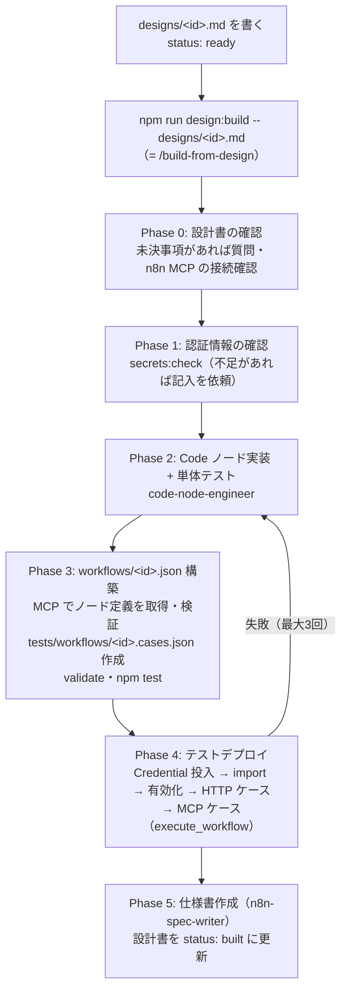

# 設計書からの自動構築

`designs/` に設計書（Markdown）を置くと、Claude Code がワークフローの構築からローカル n8n でのテストまでを自動で行います。

## 流れ



## 実行コマンド

| コマンド | 動作 |
| --- | --- |
| `npm run design:build -- designs/<id>.md` | Claude Code を対話モードで起動し、構築を開始（推奨。質問・許可確認あり） |
| `npm run design:build -- designs/<id>.md --auto` | `claude -p` の非対話モードで最後まで実行。未決事項は設計書に書き込んで停止 |
| `npm run design:build` | `status: ready` の設計書が 1 つだけならそれを構築 |
| `npm run design:list` | 設計書の一覧と status |

`design:build` は実行前に front matter を確認し、`status: draft` や `id` の形式不正なら Claude を起動せずに止まります。
`--auto` で Claude に許可するコマンドは `scripts/lib/claude-cli.js` の `AUTO_ALLOWED_TOOLS` で管理しています（`.claude/settings.json` の deny は `--auto` でも有効です）。

## 事前準備（初回のみ）

1. ローカル n8n を起動し、オーナーアカウントを作成する（[getting-started.md](getting-started.md)）
2. n8n MCP を接続する（[claude-code.md の「初回の接続」](claude-code.md#初回の接続1-回だけ)）。
   Claude はこれでノードの正しい定義を取り出して検証し、Form などのワークフローもテストで実行できます
3. n8n の UI で **Settings > n8n API** を開いて API キーを発行し、`secrets/secrets.env` の `N8N_API_KEY` に記入する
   （Webhook のテストデプロイで、ワークフローの有効化・無効化に使います。未入力でも、MCP で処理結果までは確認できます）
4. 設計書で使うサービスの認証情報を `secrets/secrets.env` に記入する（[secrets.md](secrets.md)）

すべて n8n の無料版と Claude Code のサブスクリプションの範囲で動きます。n8n の AI ビルダーは使いません。

## 設計書の書き方

`designs/_TEMPLATE.md` をコピーして書きます。記入例は `designs/examples/order-notify.md` を参照してください。

| セクション | 書く内容 | Claude の使い方 |
| --- | --- | --- |
| front matter | `id`・`title`・`category`・`status`・`owner` | ファイル名、n8n 上の名前、分類タグ（Dashy のセクション）、構築してよいかの判断 |
| 1. 目的・背景 | 何のためのワークフローか | 仕様書の「目的」 |
| 2. トリガー | 種類、パス、スケジュールなど | トリガーノードの設定 |
| 3. 入力データ | 項目の表と JSON の例 | Code ノードの入力、テストデータ |
| 4. 処理ステップ | 1 ステップ = おおむね 1 ノード | ノード構成。種類が「Code」のものは JS で実装してテストを付ける |
| 5. 分岐条件 | IF / Switch の条件 | 分岐ノードと接続 |
| 6. 出力・外部連携 | 出力先と内容 | 出力ノードの設定 |
| 7. 認証情報・設定値 | Credential の name、`$env` のキー | `credentials` の参照、`$env` の式 |
| 8. エラーハンドリング | 入力不正、外部 API 失敗時の扱い | リトライ設定、エラー時の応答 |
| 9. テストケース | request / expect の JSON | `tests/workflows/<id>.cases.json` に変換し、テストデプロイで実行 |
| 10. 非機能要件 | 頻度、タイムアウトなど | 仕様書に記載 |
| 11. 未決事項 | 決まっていないこと | 構築前にユーザーへ質問 |

### 精度を上げるコツ
- 入出力は文章より **JSON の例** で書く
- 条件は `amount >= 100000` のように **式** で書く
- 1 ステップで複数のことをしない。計算・整形・判定は「Code」ステップにまとめると、単体テストで確実に検証される
- テストケースの `expect.json` は部分一致なので、**確かめたい項目だけ** を書く

## テストデプロイの仕組み

`npm run n8n:test -- workflows/<id>.json`（`scripts/n8n-test-run.js`）が次を行います。

1. `tests/workflows/<id>.cases.json` を読み込む
2. n8n Public API でワークフローがインポート済みか確認し、未公開なら公開（publish）する。n8n 2.x 以降の `publish` が無い古いバージョンでは `activate` を使う
3. 各ケースのリクエストを本番 Webhook URL（`http://localhost:5678/webhook/<path>`）に送信し、ステータスとレスポンスを照合する
4. もともと無効だった場合は無効に戻す（`--keep-active` で有効のまま残す）

`/build-from-design` は、Form / Webhook トリガーのワークフローを `--keep-active` で公開したままにします（Dashy からすぐ使えるように）。
Schedule やアプリのイベントのトリガーは、公開すると自動で動き出すため、公開するかはユーザーに任せます。

`npm run n8n:import` は、取り込む前に公開中だったワークフローを、取り込んだ後に公開し直します（n8n の `import:workflow` は
取り込んだワークフローを非公開にするため。`N8N_API_KEY` が必要）。

テストケースのファイル形式:

```json
{
  "workflow": "workflows/order-notify.json",
  "cases": [
    {
      "name": "高額注文は high として処理される",
      "request": { "method": "POST", "path": "order-notify", "query": {}, "headers": {}, "body": { "amount": 150000 } },
      "expect": { "status": 200, "json": { "priority": "high" }, "textContains": "..." }
    }
  ]
}
```

### Webhook 以外のトリガー（MCP ケース）

Form・Schedule・Manual トリガーのワークフローは、`request` の代わりに `trigger`（トリガーノード名）を書きます。
`n8n:test` はこのケースをスキップし（`skipped (MCP)` と表示）、Claude が n8n MCP の `execute_workflow` で実行して判定します。

```json
{
  "name": "フォーム送信で受付番号が作られる",
  "trigger": "Form Trigger",
  "inputs": { "formData": { "name": "Alice", "email": "alice@example.com" } },
  "expect": { "status": "success", "node": "Build Reply", "json": { "accepted": true } }
}
```

| 項目 | 内容 |
| --- | --- |
| `trigger` | トリガーノードの名前 |
| `inputs` | MCP の `execute_workflow` に渡す入力。Form は `formData`、Webhook は `webhookData`（`method`・`body`・`query`・`headers`）。Schedule・Manual は省略 |
| `expect.status` | 実行のステータス（`success` / `error`） |
| `expect.node` / `expect.json` | 指定したノードの出力の 1 件目を、`json` と部分一致で比べる |

Form Trigger の出力は、各項目が `fieldName` をキーにして `$json` の直下に並び、`submittedAt` と `formMode` が自動で付きます。
MCP から渡した `formData` は型変換や必須チェックを通らないため、ブラウザから送ったときの細かい挙動は、
フォーム（`http://localhost:5678/form/<path>`）から実際に送って確認してください。

### 注意点
- テストでは実際にワークフローが動きます。Slack への投稿などの副作用も発生するため、テスト用のチャンネルやアカウントを `secrets/secrets.env` に設定しておくと安全です。
- MCP ケースの無い Webhook 以外のトリガー（スケジュールなど）は、有効化できるかどうかまでを自動で確認します。実行結果の確認は、設計書に書いた方法で行ってください。
- n8n MCP が未接続の場合、Claude は MCP ケースを実行せず、その旨を報告します。
- 本番環境へのデプロイは行いません（ローカル n8n のみ）。

## 関連ファイル

| ファイル | 役割 |
| --- | --- |
| `designs/_TEMPLATE.md` | 設計書のひな形 |
| `designs/examples/order-notify.md` | 記入例 |
| `.claude/skills/build-from-design/SKILL.md` | 自動構築の手順（Claude が従う） |
| `scripts/n8n-test-run.js`、`scripts/lib/case-runner.js` | テストデプロイ |
| `tests/workflows/*.cases.json` | ワークフローのテストケース |
