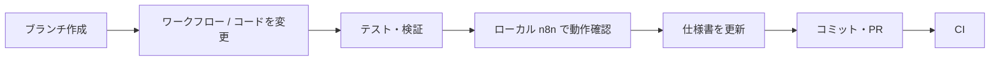

# 開発の進め方

## 全体の流れ



## ワークフローを新規作成・変更する

ワークフローを編集する方法は 2 通りあります。

### A. n8n の UI で編集する（ノードの配置を試行錯誤したいとき）
1. `npm run n8n:import` で最新の JSON を n8n に取り込む
2. UI で編集して保存する
3. `npm run n8n:export -- <workflowId>` で `workflows/<id>.json` に書き出す
   - 既存ファイル（例: `contacts-intake.json`）を更新する場合は、出力された内容を既存ファイルに反映し、`<id>.json` は削除する
4. `git diff workflows/` で意図した変更だけが入っているか確認する
5. `settings` に `"availableInMCP": true` が無ければ追加する（`npm run validate:workflows` で必須。n8n MCP から実行・テストするために使う）

### B. JSON を直接編集する（Claude Code に任せるとき・小さな修正のとき）
- 必須項目と書き方は `.claude/agents/n8n-workflow-expert.md` の「ワークフロー JSON のルール」を参照してください。
- 変更後に `npm run validate:workflows` を実行します。

## Code ノードを追加・変更する

1. `src/javascript/code-nodes/<name>.js` を作成し、`run(items)` を実装する

   ```js
   function run(items) {
     return items.map((item) => ({ json: { ...item.json, processed: true } }));
   }
   module.exports = { run };
   ```

2. `tests/javascript/<name>.test.js` にテストを書き、`npm test` で確認する
3. ワークフロー JSON の Code ノードの `jsCode` を、次の 1 行だけにする

   ```json
   "parameters": { "jsCode": "// @source src/javascript/code-nodes/<name>.js\n" }
   ```

4. `npm run sync:code` を実行すると、ソースが埋め込まれた状態になる

   ```js
   // @source src/javascript/code-nodes/<name>.js
   // AUTO-GENERATED by `npm run sync:code`. ...
   const module = { exports: {} };
   const exports = module.exports;
   ...ソース本体...
   return module.exports.run($input.all());
   ```

**注意**
- 埋め込まれた後の `jsCode` を n8n の UI で直接書き換えないでください。次の `sync:code` で上書きされます。
- Code ノードのモードは「Run Once for All Items」（既定）を前提としています。
- 外部の npm パッケージを `require` する場合は、n8n 側で `NODE_FUNCTION_ALLOW_EXTERNAL` の設定が必要です。
- ソースを変更して同期し忘れると、CI の `sync:code:check` が失敗します。

## Python 処理を追加・変更する

1. `src/python/data_processing/` にモジュールを追加し、型ヒントと docstring を付ける
2. CLI から使う場合は `__main__.py` にサブコマンドを追加する
3. `tests/python/test_<name>.py` にテストを書く
4. 確認する

   ```bash
   .venv/bin/ruff check . && .venv/bin/ruff format --check .
   .venv/bin/pytest
   echo '[{"id":1,"name":" a "},{"id":1}]' | PYTHONPATH=src/python .venv/bin/python -m data_processing clean --key id
   ```

## ローカル n8n で動作確認する

```bash
npm run n8n:import -- workflows/<name>.json
```

- テスト用 Webhook URL: `http://localhost:5678/webhook-test/<path>`（UI で「Test workflow」を押している間だけ有効）
- 本番用 Webhook URL: `http://localhost:5678/webhook/<path>`（ワークフローを有効化した場合のみ）
- Credential はインポートされません。UI で作成して、各ノードに割り当ててください。

## 仕様書を更新する

ノード・接続・Code ノード・Python 処理を変更したら、仕様書を更新します。

- Claude Code で作業している場合: 編集するとフックが通知するので、`n8n-spec-writer` サブエージェントに任せます（「仕様書を更新して」と依頼するだけでも動きます）。
- 手作業の場合: `npm run describe -- workflows/<name>.json` の出力を参考に、`doc/specifications/_TEMPLATE.md` に沿って書きます。

## コミット前のチェックリスト

- [ ] `npm run ci` が成功する
- [ ] `.venv/bin/ruff check .`・`.venv/bin/ruff format --check .`・`.venv/bin/pytest` が成功する
- [ ] ワークフロー JSON に秘密情報や `pinData` が含まれていない
- [ ] `doc/specifications/` の仕様書が更新されている
