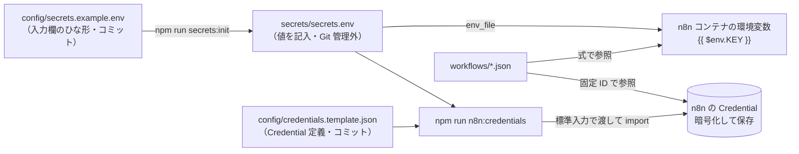

# 認証情報・API キーの管理

API キーやトークンは `secrets/secrets.env` の 1 ファイルにまとめて管理します。`secrets/` は `.gitignore` 済みのため、Git には登録されません。

## 全体像



| ファイル | Git | 役割 |
| --- | --- | --- |
| `config/secrets.example.env` | 管理する | 必要なキーの一覧と説明（値は空） |
| `config/credentials.template.json` | 管理する | n8n の Credential 定義。値は `${KEY}` で secrets.env を参照 |
| `secrets/secrets.env` | **管理しない** | 実際の値を記入するファイル |

## 初回セットアップ

```bash
npm run secrets:init      # secrets/secrets.env を作成（権限 600）
# secrets/secrets.env をエディタで開いて、使うサービスの値を記入する
npm run secrets:check     # 入力状況の確認（値は表示されない）
npm run n8n:up            # 起動済みなら: docker compose up -d --force-recreate n8n
npm run n8n:credentials   # 値がそろっている Credential を n8n に一括登録
```

`secrets:check` の出力例:

```
✓ SLACK_BOT_TOKEN              set
· OPENAI_API_KEY               empty
...
n8n Credentials:
  ✓ Slack Bot (slackApi, id=credSlackBot0001)
  · OpenAI — 未入力: OPENAI_API_KEY
```

## 用意されている項目

| サービス | キー | 種類 | n8n の Credential |
| --- | --- | --- | --- |
| n8n Public API | `N8N_API_KEY` | スクリプト用 | —（テストデプロイで使用） |
| Slack | `SLACK_BOT_TOKEN` | cred | Slack Bot（`credSlackBot0001`） |
| | `SLACK_DEFAULT_CHANNEL`, `SLACK_WEBHOOK_URL` | env | — |
| OpenAI | `OPENAI_API_KEY`, `OPENAI_ORGANIZATION_ID`（任意） | cred | OpenAI（`credOpenAi000001`） |
| Anthropic | `ANTHROPIC_API_KEY` | cred | Anthropic（`credAnthropic001`） |
| Notion | `NOTION_API_KEY` | cred | Notion（`credNotion000001`） |
| GitHub | `GITHUB_USER`, `GITHUB_TOKEN` | cred | GitHub（`credGitHub000001`） |
| 汎用 API | `GENERIC_API_HEADER_NAME`, `GENERIC_API_HEADER_VALUE` | cred | Generic API (Header)（`credGenericHdr01`） |
| | `GENERIC_API_BASE_URL` | env | — |
| SMTP | `SMTP_HOST`, `SMTP_PORT`, `SMTP_USER`, `SMTP_PASSWORD`, `SMTP_SECURE` | cred | SMTP（`credSmtp00000001`） |
| | `SMTP_FROM` | env | — |
| 外部 PostgreSQL | `EXT_PG_HOST`, `EXT_PG_PORT`, `EXT_PG_DATABASE`, `EXT_PG_USER`, `EXT_PG_PASSWORD` | cred | External Postgres（`credExtPostgres1`） |
| Discord | `DISCORD_WEBHOOK_URL` | env | — |

- **cred**: n8n の Credential に変換されます。n8n の中では暗号化して保存されます。
- **env**: n8n コンテナの環境変数になり、式で `{{ $env.KEY }}` として使えます。秘密ではない設定値向けです。

> ローカル開発を簡単にするため、`secrets/secrets.env` のすべてのキーが n8n コンテナの環境変数として渡されます（cred 用のキーも `$env` から見えます）。本番環境では、n8n の Credential だけを使い、`N8N_BLOCK_ENV_ACCESS_IN_NODE=true` にすることを推奨します。

## ワークフローからの参照方法

### Credential（API キー・トークン）

ノードの `credentials` に、テンプレートの `id` と `name` を書きます。

```json
{
  "name": "Post to Slack",
  "type": "n8n-nodes-base.slack",
  "credentials": {
    "slackApi": { "id": "credSlackBot0001", "name": "Slack Bot" }
  }
}
```

ID が固定なので、どの環境でインポートしても同じ Credential に結び付きます。

### 設定値（$env）

```json
"parameters": {
  "channel": "={{ $env.SLACK_DEFAULT_CHANNEL }}",
  "url": "={{ $env.GENERIC_API_BASE_URL }}/v1/items"
}
```

`secrets/secrets.env` の値を変えた後は、`docker compose up -d --force-recreate n8n` で反映させます。

## 新しいサービスを追加する

1. `config/secrets.example.env` にキーを追加する（`[cred]` / `[env]` の注記を付ける）
2. Credential が必要なら `config/credentials.template.json` に追加する

   ```json
   {
     "id": "credMyService001",
     "name": "My Service",
     "type": "httpHeaderAuth",
     "data": { "name": "X-API-Key", "value": "${MY_SERVICE_API_KEY}" }
   }
   ```

   - `id` は 16 文字の英数字で、ほかと重複しないもの
   - `type` と `data` のフィールド名は n8n の Credential の型に合わせる（不明なら `httpHeaderAuth` が汎用的に使えます）
   - 値の書き方: `${KEY}`（必須）、`${KEY?}`（任意・未入力なら項目を省略）、`${KEY:number}`、`${KEY:boolean}`
3. `npm run secrets:init` を実行すると、追加したキーが `secrets/secrets.env` に空欄で追記される（既存の値はそのまま）
4. 値を記入して `npm run n8n:credentials`

`npm test` は、テンプレートで使っているキーがすべて `secrets.example.env` に定義されているか、ID と名前が重複していないかを確認します。

## 安全のための仕組み

| 仕組み | 内容 |
| --- | --- |
| `.gitignore` | `secrets/` をまるごと除外 |
| 平文ファイルを残さない | `n8n:credentials` は値を埋め込んだ JSON を標準入力でコンテナに渡し、コンテナ内の一時ファイルもインポート後すぐに削除 |
| 値を表示しない | `secrets:check` はキー名と入力状況だけを表示。値を出力する内部コマンドは `n8n-credentials.sh` からしか動かない |
| 直書きの検出 | `npm run validate:workflows`（CI でも実行）が、ワークフロー JSON 内のトークンらしき文字列（`sk-…`、`xoxb-…`、Slack/Discord の Webhook URL、`Bearer …` など）と、テンプレートに無い Credential ID の参照をエラーにする |
| Claude Code の権限 | `secrets/` の読み書きと、値を出力するコマンドの実行を `deny` に設定。Claude は値を見ずに作業する |

## トラブルシューティング

| 症状 | 対処 |
| --- | --- |
| `n8n:credentials` で一部が `skip` になる | `npm run secrets:check` で未入力のキーを確認する |
| ワークフローで `$env.KEY` が空になる | `docker compose up -d --force-recreate n8n` で環境変数を再読み込みする |
| `access to env vars denied` と表示される | `docker-compose.yml` の `N8N_BLOCK_ENV_ACCESS_IN_NODE` が `'false'` になっているか確認する |
| Credential の型が合わずにインポートで失敗する | `config/credentials.template.json` の `type` と `data` のフィールド名を、n8n の UI で作成した Credential をエクスポート（`n8n export:credentials --decrypted`）して照合する |
