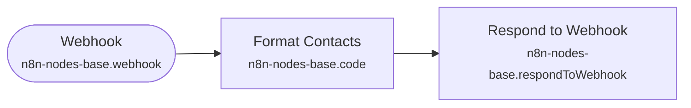

# Contacts Intake (Webhook → Format → Respond)

> このファイルは `n8n-spec-writer` が `workflows/contacts-intake.json` から生成しています。「9. 補足（手動記述）」以外を手で編集した場合、次回の更新で上書きされる可能性があります。

## 1. 概要

| 項目 | 内容 |
| --- | --- |
| 目的 | Webhook で受け取った連絡先データを正規化・検証・重複排除し、結果を呼び出し元に返す（サンプルワークフロー）。業務上の用途は **要確認** |
| ワークフローファイル | `workflows/contacts-intake.json` |
| ワークフロー ID | `ContactsIntake01` |
| トリガー | Webhook（POST `/contacts-intake`、レスポンスは Respond to Webhook ノードで返す） |
| 有効状態（リポジトリ上） | `false`（無効） |
| 関連ソース | `src/javascript/code-nodes/format-contacts.js` |
| 関連テスト | `tests/javascript/format-contacts.test.js` |

## 2. 処理フロー



Webhook が受け取ったリクエストボディを Format Contacts に渡します。Format Contacts は全件をまとめて処理し、正常な連絡先・不正な連絡先・件数のサマリーを 1 件のアイテムにして出力します。Respond to Webhook はそのアイテムを JSON のレスポンスとして返します。

## 3. ノード一覧

| # | ノード名 | 種類 | 役割 |
| --- | --- | --- | --- |
| 1 | Webhook | `n8n-nodes-base.webhook` (v2) | POST リクエストを受け付ける |
| 2 | Format Contacts | `n8n-nodes-base.code` (v2) | 連絡先の正規化・検証・重複排除 |
| 3 | Respond to Webhook | `n8n-nodes-base.respondToWebhook` (v1.1) | 処理結果を JSON で返す |

## 4. ノード詳細

### 4.1 Webhook

- **種類**: `n8n-nodes-base.webhook`
- **入力**: HTTP リクエスト
- **処理**: `httpMethod: POST`、`path: contacts-intake`、`responseMode: responseNode`（レスポンスは後段の Respond to Webhook で返す）
- **出力**: `{ headers, params, query, body }` 形式のアイテム 1 件
- **エラー時**: 既定（ワークフロー停止）

### 4.2 Format Contacts

- **種類**: `n8n-nodes-base.code`（Run Once for All Items）
- **入力**: Webhook のアイテム
- **処理**: `src/javascript/code-nodes/format-contacts.js` の `run(items)` を実行する
  1. レコードの取り出し（`extractRecords`）: `json.body` があれば body を使い、無ければ `json` 自体を使う。その中身が配列ならそのまま、`contacts` 配列があればそれを、オブジェクトなら 1 件として扱う
  2. 正規化
     - `name`: 前後の空白を除去し、連続する空白を 1 つにまとめる。文字列でなければ空文字
     - `email`: 前後の空白を除去して小文字化し、`^[^\s@]+@[^\s@]+\.[^\s@]+$` に一致しなければ `null`
     - `phone`: 数字と `+` 以外を除去する。空になる、または値が無い場合は `null`
  3. `email` が `null` のレコードは `invalid` に入れる（`rawEmail` に元の値、`reason: "invalid_email"`）
  4. 正規化後の `email` が既出のレコードは捨てる（先に出たものを残す）
- **出力**: アイテム 1 件 `{ contacts, invalid, summary: { valid, invalid } }`
- **エラー時**: 既定（ワークフロー停止）

### 4.3 Respond to Webhook

- **種類**: `n8n-nodes-base.respondToWebhook`
- **入力**: Format Contacts の出力
- **処理**: `respondWith: json`、`responseBody: ={{ $json }}`（入力アイテムをそのまま返す）
- **出力**: HTTP レスポンス（ステータス 200）
- **エラー時**: 既定（ワークフロー停止）

## 5. 入出力仕様

### 入力
`Content-Type: application/json` の POST。次のどの形式でも受け付けます。

```json
{ "contacts": [{ "name": "Alice", "email": "alice@example.com", "phone": "090-1111-2222" }] }
```
```json
[{ "name": "Alice", "email": "alice@example.com" }]
```
```json
{ "name": "Alice", "email": "alice@example.com" }
```

| フィールド | 必須 | 説明 |
| --- | --- | --- |
| `email` | ○ | 不正な値は `invalid` に入る |
| `name` | — | 省略時は空文字 |
| `phone` | — | 省略時は `null` |

### 出力

```json
{
  "contacts": [{ "name": "Alice", "email": "alice@example.com", "phone": "09011112222" }],
  "invalid": [
    { "name": "Bob", "email": null, "phone": null, "rawEmail": "bob@@example", "reason": "invalid_email" }
  ],
  "summary": { "valid": 1, "invalid": 1 }
}
```

## 6. 外部連携・Credential・環境変数

なし。

## 7. エラーハンドリングと制約

- 不正なメールアドレスはエラーにせず `invalid` に入れて返します。
- 重複はメールアドレス（正規化後）で判定します。重複して捨てたレコードは `invalid` にも件数にも含まれません。
- Webhook に認証が設定されていないため、URL を知っていれば誰でも呼び出せます。公開する場合は認証の追加が必要です（**要確認**）。
- 1 回のリクエストで受け付ける件数の上限は設定されていません（**要確認**）。

## 8. テスト

| テストファイル | 確認している内容 |
| --- | --- |
| `tests/javascript/format-contacts.test.js` | 正規化関数（メール・名前・電話）、ボディ形式ごとのレコード取り出し、`run` の出力形式（正常・不正・重複・空入力） |
| `tests/javascript/workflow-validator.test.js` | `workflows/contacts-intake.json` の構造の妥当性 |

## 9. 補足（手動記述）

<!-- 人間が自由に記述する欄。n8n-spec-writer はこの欄を変更しない -->

## 10. 変更履歴

| 日付 | 内容 |
| --- | --- |
| 2026-11-14 | 初版作成 |
