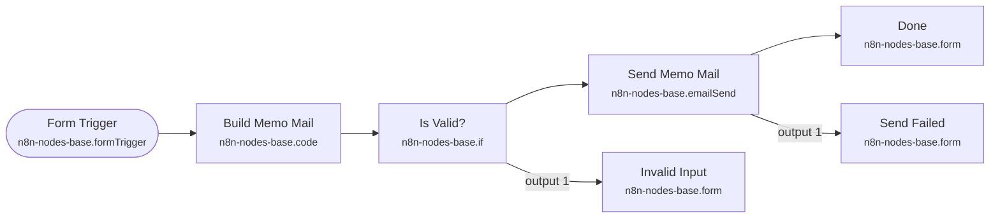

# メモを自分の Gmail に送る

> このファイルは `n8n-spec-writer` が `workflows/memo-to-gmail.json` から生成しています。「9. 補足（手動記述）」以外を手で編集した場合、次回の更新で上書きされる可能性があります。

## 1. 概要

| 項目 | 内容 |
| --- | --- |
| 目的 | 思いついたことやあとでやることを、フォームからすぐに自分の Gmail へ送って残す。件名の頭に「[メモ]」と日時を付け、Gmail で検索・振り分けしやすくする。利用者は本人のみ（設計書 `designs/memo-to-gmail.md`） |
| ワークフローファイル | `workflows/memo-to-gmail.json` |
| ワークフロー ID | `1uLVnIsVtSyS4cLe` |
| 分類 | `OPS` 社内業務・運用（config/categories.yml） |
| トリガー | Form Trigger（`/form/memo-to-gmail`、ローカルでは http://localhost:5678/form/memo-to-gmail） |
| 有効状態（リポジトリ上） | `false` |
| 関連ソース | `src/javascript/code-nodes/memo-to-gmail-build-memo-mail.js` |
| 関連テスト | `tests/javascript/memo-to-gmail-build-memo-mail.test.js`、`tests/workflows/memo-to-gmail.cases.json` |

## 2. 処理フロー



フォームで受け取った件名・メモから、Build Memo Mail がメールの件名・本文と入力チェック結果（`valid`）を作ります。
Is Valid? が `valid` で分岐し、true なら Send Memo Mail が SMTP で自分宛て（`SMTP_FROM`）にメールを送り、完了画面 Done を表示します。
メモが空の場合は Invalid Input、送信がリトライ後も失敗した場合はエラー出力から Send Failed の完了画面を表示します。

## 3. ノード一覧

| # | ノード名 | 種類 | 役割 |
| --- | --- | --- | --- |
| 1 | Form Trigger | `n8n-nodes-base.formTrigger` (v2.6) | 件名・メモを入力するフォームを公開し、送信内容を受け取る |
| 2 | Build Memo Mail | `n8n-nodes-base.code` (v2) | 件名・本文・送信日時を組み立て、メモが空かを判定する |
| 3 | Is Valid? | `n8n-nodes-base.if` (v2.4) | `valid` が true かで送信 / 入力不正に分岐する |
| 4 | Send Memo Mail | `n8n-nodes-base.emailSend` (v2.1) | SMTP で自分宛てにメールを送る（リトライ・エラー出力あり） |
| 5 | Done | `n8n-nodes-base.form` (v2.5) | 送信完了の画面を表示する |
| 6 | Invalid Input | `n8n-nodes-base.form` (v2.5) | メモが空のときのエラー画面を表示する |
| 7 | Send Failed | `n8n-nodes-base.form` (v2.5) | メール送信に失敗したときのエラー画面を表示する |

## 4. ノード詳細

### 4.1 Form Trigger

- **種類**: `n8n-nodes-base.formTrigger`
- **入力**: フォームの送信内容
- **処理**:
  - パス `memo-to-gmail`（`/form/memo-to-gmail`）、タイトル「メモをメールで送る」、説明「入力したメモを自分の Gmail に送ります」、ボタン「送信」
  - 項目: `title`（件名・text・任意、プレースホルダ「空欄ならメモの先頭 20 文字を使います」）、`memo`（メモ・textarea・必須）
  - `responseMode: lastNode`（最後に実行されたフォーム完了ノードの内容を表示する）
  - フォームの認証は設定されていない
- **出力**: `{ title, memo, submittedAt, ... }`（`submittedAt` はフォームトリガーが付ける送信日時。ワークフローのタイムゾーンは `Asia/Tokyo`）
- **エラー時**: 既定（ワークフロー停止）

### 4.2 Build Memo Mail

- **種類**: `n8n-nodes-base.code`
- **入力**: Form Trigger の出力
- **処理**: ソース `src/javascript/code-nodes/memo-to-gmail-build-memo-mail.js`（`npm run sync:code` で埋め込み）。全アイテムを一括で処理し、入力 1 件につき 1 件を同じ順序で返す。
  - `memo`: 文字列以外は空として扱い、前後の空白を取り除く。空になれば `valid: false`、`errors: ["memo_required"]`
  - `subjectTitle`:
    - `memo` があり、`title`（前後の空白を除く）が空でなければ `title`
    - `title` が空なら、`memo` の改行（`\r\n` / `\r` / `\n`）を半角スペースに置き換えたもの。コードポイント単位（絵文字も 1 文字）で 20 文字を超えたら先頭 19 文字＋「…」（計 20 文字）。ちょうど 20 文字なら切り詰めない
    - `memo` が空のときは `title`（前後の空白を除く。無ければ空文字）
  - `sentAtText`: `submittedAt` を日本時間（UTC+9 固定）の `YYYY-MM-DD HH:mm` にする。`submittedAt` が無い・空文字・解析できない場合は実行時の現在時刻を使う
  - `subject` = `[メモ] {sentAtText} {subjectTitle}`
  - `text` = `{memo（前後の空白を除いたもの。内部の改行はそのまま）}\n\n---\n送信日時: {sentAtText}`
- **出力**: `{ valid, errors, subjectTitle, sentAtText, subject, text }`（`memo` が空でも `subject`・`text` は作られる）
- **エラー時**: 既定（ワークフロー停止）

### 4.3 Is Valid?

- **種類**: `n8n-nodes-base.if`
- **入力**: Build Memo Mail の出力
- **処理**: `{{ $json.valid }}` が boolean の true か（`typeValidation: strict`）
- **出力**:
  - true（output 0）→ Send Memo Mail
  - false（output 1）→ Invalid Input
- **エラー時**: 既定（ワークフロー停止）

### 4.4 Send Memo Mail

- **種類**: `n8n-nodes-base.emailSend`
- **入力**: Is Valid? の true 出力（Build Memo Mail の出力）
- **処理**:
  - `operation: send`、送信元 `fromEmail` と宛先 `toEmail` はどちらも `{{ $env.SMTP_FROM }}`
  - 件名 `{{ $json.subject }}`、形式 `text`、本文 `{{ $json.text }}`
  - `appendAttribution: false`（n8n による自動送信の一文を付けない）
  - Credential: SMTP（`smtp`）
- **出力**:
  - 成功（output 0）→ Done
  - エラー（output 1）→ Send Failed
- **エラー時**: リトライあり（`maxTries: 3` = 最大 3 回試行、`waitBetweenTries: 5000` = 5 秒間隔）。すべて失敗した場合は `onError: continueErrorOutput` によりエラー出力から Send Failed へ進む

### 4.5 Done

- **種類**: `n8n-nodes-base.form`
- **入力**: Send Memo Mail の成功出力
- **処理**: `operation: completion`、`respondWith: text`。タイトル「メモを送信しました」、メッセージ「Gmail を確認してください。件名: {{ $('Build Memo Mail').item.json.subject }}」
- **出力**: フォームの完了画面
- **エラー時**: 既定（ワークフロー停止）

### 4.6 Invalid Input

- **種類**: `n8n-nodes-base.form`
- **入力**: Is Valid? の false 出力
- **処理**: `operation: completion`、`respondWith: text`。タイトル「送信できませんでした」、メッセージ「メモが空です。内容を入力してもう一度送信してください。」
- **出力**: フォームの完了画面
- **エラー時**: 既定（ワークフロー停止）

### 4.7 Send Failed

- **種類**: `n8n-nodes-base.form`
- **入力**: Send Memo Mail のエラー出力
- **処理**: `operation: completion`、`respondWith: text`。タイトル「送信に失敗しました」、メッセージ「メールを送信できませんでした。SMTP の設定（アプリパスワードなど）を確認してください。」
- **出力**: フォームの完了画面
- **エラー時**: 既定（ワークフロー停止）

## 5. 入出力仕様

### 入力

ブラウザで `/form/memo-to-gmail`（ローカルでは http://localhost:5678/form/memo-to-gmail）を開き、フォームから送信します。

| fieldName | ラベル | 種類 | 必須 | 説明 |
| --- | --- | --- | --- | --- |
| `title` | 件名 | text | — | メールの件名に使う。空欄（空白のみを含む）ならメモの先頭 20 文字を使う |
| `memo` | メモ | textarea | ○ | メールの本文。前後の空白は除き、内部の改行はそのまま残す |

Form Trigger の出力例:

```json
{
  "title": "買い物リスト",
  "memo": "牛乳\n卵\nパン",
  "submittedAt": "2026-11-14T10:30:00.000+09:00"
}
```

### 出力

Build Memo Mail の出力例（Send Memo Mail はこの `subject` / `text` で送信する）:

```json
{
  "valid": true,
  "errors": [],
  "subjectTitle": "買い物リスト",
  "sentAtText": "2026-11-14 10:30",
  "subject": "[メモ] 2026-11-14 10:30 買い物リスト",
  "text": "牛乳\n卵\nパン\n\n---\n送信日時: 2026-11-14 10:30"
}
```

送信されるメール:

| 項目 | 値 |
| --- | --- |
| From / To | `SMTP_FROM`（自分の Gmail アドレス） |
| 件名 | `[メモ] YYYY-MM-DD HH:mm {subjectTitle}` |
| 本文（テキスト） | メモ ＋ 空行 ＋ `---` ＋ `送信日時: YYYY-MM-DD HH:mm` |

フォームの完了画面:

| 状況 | タイトル | メッセージ |
| --- | --- | --- |
| 送信成功 | メモを送信しました | Gmail を確認してください。件名: {subject} |
| メモが空 | 送信できませんでした | メモが空です。内容を入力してもう一度送信してください。 |
| 送信失敗 | 送信に失敗しました | メールを送信できませんでした。SMTP の設定（アプリパスワードなど）を確認してください。 |

## 6. 外部連携・Credential・環境変数

| 種類 | 名前（n8n 上） | 使用ノード | 備考 |
| --- | --- | --- | --- |
| `smtp`（Credential） | SMTP | Send Memo Mail | Gmail の SMTP（アプリパスワード）を想定。値は `config/credentials.template.json` の定義に従い `SMTP_HOST`・`SMTP_PORT`・`SMTP_USER`・`SMTP_PASSWORD`・`SMTP_SECURE` から投入する（`npm run n8n:credentials`） |
| 環境変数 | `SMTP_FROM` | Send Memo Mail | 送信元と宛先の両方に使う自分の Gmail アドレス（`{{ $env.SMTP_FROM }}`） |

ワークフロー設定 `settings.availableInMCP: true` により、CLI（`npm run n8n:import`）でインポートした後も n8n MCP サーバーから参照・実行できます。

## 7. エラーハンドリングと制約

- メモが空（未入力・空白や改行のみ）の場合はメールを送らず、Invalid Input の画面を表示します。`memo` はフォーム上で必須のため、まったくの空欄はフォーム側で送信できません。
- SMTP 送信に失敗した場合は最大 3 回試行（5 秒間隔、つまりリトライ 2 回）し、それでも失敗したら Send Failed の画面で SMTP 設定の確認を案内します。実行は n8n の実行履歴に残ります。
- エラー通知（Slack・メール等）はありません。本人がフォームの画面でその場で確認する想定です（設計書より）。
- フォームに認証は設定されていません。ローカル環境で本人だけが使う想定です（設計書より）。
- 件名の日時は UTC+9 固定で計算します（夏時間等は考慮しない）。
- 想定実行頻度は 1 日数件〜数十件（本人のみ）、実行時間帯の制約はありません（設計書より）。
- 設計書の非機能要件は「30 秒以内に完了画面を表示（リトライを含む）」です。リトライ待ちは計 10 秒ですが、SMTP 接続がタイムアウトする場合の 1 回あたりの所要時間はワークフロー上で制限していないため、失敗時に 30 秒以内に収まるかは実装からは保証できません（**要確認**: SMTP 接続失敗時の所要時間と、30 秒の要件を満たせるか）。

## 8. テスト

| テストファイル | 確認している内容 |
| --- | --- |
| `tests/javascript/memo-to-gmail-build-memo-mail.test.js` | 件名・本文・送信日時の組み立て、`title` の優先と空白除去、`memo` が空・非文字列のときの `memo_required`、件名の 20 文字切り詰め（ちょうど 20 文字・21 文字・絵文字・改行の置換）、`submittedAt` が無い/不正なときの現在時刻へのフォールバック、UTC→JST 変換と日付またぎ、`items` の境界値（空配列・配列以外・`json` 無し・複数件の順序） |
| `tests/javascript/workflow-validator.test.js` | `workflows/` 配下の全ワークフローについて、構造・Credential 参照・分類タグの妥当性 |
| `tests/workflows/memo-to-gmail.cases.json` | テストデプロイ用 3 件: 件名ありで送信（`subjectTitle: "テスト件名"`）、件名が空ならメモ先頭 20 文字（「…」付き）を件名にする、メモが空白のみなら `valid: false` / `memo_required`。いずれも Build Memo Mail の出力で判定 |

- テストデプロイ（`npm run n8n:test -- workflows/memo-to-gmail.json`）の結果: **未実施**（SMTP の値が未入力のため）。
- ケース 1・2 を実行すると、実際に自分の Gmail へメールが 1 通ずつ届きます。件名の日時は実行時刻で変わるため、自動判定は日時を含まない項目（`subjectTitle` など）で行います。
- ケース 3 は、実行履歴で Send Memo Mail が実行されず Invalid Input まで進んでいることを手動で確認します。

## 9. 補足（手動記述）

<!-- 人間が自由に記述する欄。n8n-spec-writer はこの欄を変更しない -->

## 10. 変更履歴

| 日付 | 内容 |
| --- | --- |
| 2026-11-14 | 初版作成 |
