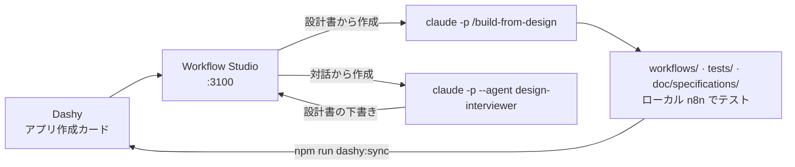

# Workflow Studio（アプリ作成）

ワークフロー（アプリ）をブラウザから作るための小さな Web サイトです。Dashy の「アプリ作成」カードから開きます。

- URL: http://localhost:3100
- 起動: `npm run up`（n8n・Dashy と一緒にバックグラウンドで起動）。単体なら `npm run studio`（フォアグラウンド）
- 停止: `npm run down`（全部）、`npm run studio:stop`（Studio だけ）

## 2 つの作り方

### 設計書から作成
1. 左の一覧から設計書を選ぶか、「＋ 新規作成」でテンプレートを開く
2. 編集して「保存」する。新規の場合は front matter の `id` から `designs/<id>.md` に保存される
3. `status: ready` で、構築できない理由が表示されていなければ「構築を開始」を押す
4. 下の実行ログに、Claude の作業（ファイルの読み書き、テスト、n8n へのインポートなど）が流れる

構築は `npm run design:build -- designs/<id>.md --auto` と同じ内容です（[design-driven-development.md](design-driven-development.md)）。
質問できない非対話モードなので、不足があると設計書の「11. 未決事項」に質問が書き込まれて止まります。
回答を書き込んで、もう一度「構築を開始」を押してください。

### 対話から作成
1. 作りたいものをざっくり書いて送信する（Ctrl+Enter でも送信）
2. Claude が「ここまでの理解」と、おすすめの答え付きの質問（1 回に 3 つまで）を返す。「おすすめで」と返せば進む
3. 情報がそろうと、右側に設計書の下書きが表示される。その場で手直しもできる
4. 「保存」で `designs/<id>.md` に保存。「保存して構築」で、そのまま構築を始める

- 聞き取りは `design-interviewer` エージェント（`.claude/agents/design-interviewer.md`）が行います。ファイルの読み取りと、n8n MCP でのノードの確認だけができ、ファイルは書きません。保存は Studio が行います
- 人が入力して使うアプリには、トリガーとして n8n のフォームを勧めます。完成したワークフローは Dashy のカードからフォームを開いて使えます
- 会話の内容はブラウザ（localStorage）に残ります。「新しい会話」で消えます

## 費用（サブスクリプションの範囲で動かす）

Studio は Claude Code の CLI（`claude -p`）を呼び出すだけで、Agent SDK や API キーは使いません。

- 子プロセスには `ANTHROPIC_API_KEY` / `ANTHROPIC_AUTH_TOKEN` を渡さないため、Claude Code にログインしているアカウントのサブスクリプションで動きます
- 画面右上に、実行中の課金元が表示されます（「サブスクリプションで実行」）。万一「API キーで実行中」と出た場合は止めて、設定を確認してください
- 利用量はサブスクリプションの利用枠から消費されます。構築は 1 回あたりの作業量が多いため、枠に余裕があるときに実行してください

## 前提
- Claude Code がインストール済みで、ログイン済みであること（ターミナルで `claude` が動く）
- n8n MCP が接続済みであること（[claude-code.md](claude-code.md#n8n-mcp-サーバーmcpjson)）。未接続でも動きますが、ノードの確認とフォームなどのテスト実行が行われません
- 同時に動かせる処理は 1 つだけです（構築中は対話も待ちになります）

## セキュリティ

Studio は Claude にリポジトリを書き換えさせるため、このマシンのブラウザからの操作だけを受け付けます。

| 対策 | 内容 |
| --- | --- |
| 待ち受け | `127.0.0.1` のみ（`STUDIO_HOST` で変更可能。変更は推奨しない） |
| Host ヘッダー | `localhost` / `127.0.0.1` 以外は拒否（DNS リバインディング対策）。Dashy の死活確認（`host.docker.internal`）は `/` と `/api/health` の GET だけ許可 |
| 書き込み系の API | `Origin` が Studio 自身で、`Content-Type: application/json` のものだけ受け付ける（ほかのサイトからの操作を拒否） |
| 読み書きできるファイル | 設計書（`designs/` の一覧にあるもの・テンプレート）と、新規の `designs/<id>.md` だけ |
| Claude の権限 | 構築は `scripts/lib/claude-cli.js` の `AUTO_ALLOWED_TOOLS` のみ。対話は読み取りと n8n のノード参照のみ。`.claude/settings.json` の deny（`secrets/` など）は常に有効 |

## 設定

| 環境変数 | 既定値 | 説明 |
| --- | --- | --- |
| `STUDIO_PORT` | `3100` | ポート。変える場合は `config/dashboard.yml` の `studioUrl` と `statusCheckUrl` も合わせる |
| `STUDIO_HOST` | `127.0.0.1` | 待ち受けるアドレス |
| `N8N_PORT` / `DASHY_PORT` | `5678` / `4000` | 画面右上のリンク先 |

## トラブルシューティング

| 症状 | 対処 |
| --- | --- |
| Dashy の「アプリ作成」が赤い | `npm run studio:start` で起動する。`node scripts/studio-ctl.js status` で状態を確認できる |
| 「claude コマンドが見つかりません」 | Claude Code をインストールし、ターミナルで `claude` を実行してログインする |
| 「他の処理が実行中です」 | 実行中の構築や対話が終わるのを待つか、「中止」を押す |
| 起動しない | `.studio/studio.log` を確認する。ポートが使用中なら `STUDIO_PORT` を変える |
| 構築が途中で止まった | 実行ログの最後と、設計書の「11. 未決事項」を確認する。Credential の未入力なら `npm run secrets:check` |

## ファイル

| ファイル | 役割 |
| --- | --- |
| `studio/server.js` | Web サーバー（Node.js 標準モジュールのみ）と API |
| `studio/lib/jobs.js` | `claude -p` の実行と出力の中継（同時実行は 1 つ） |
| `studio/lib/design-store.js` | 設計書の一覧・読み込み・保存、下書きの取り出し |
| `studio/lib/security.js` | アクセス制限 |
| `studio/public/` | 画面（HTML / CSS / JS） |
| `scripts/lib/claude-cli.js` | `claude -p` の引数・環境変数・出力の解析（`design:build` と共通） |
| `scripts/studio-ctl.js` | バックグラウンド起動・停止（PID とログは `.studio/`） |
| `.claude/agents/design-interviewer.md` | 対話から作成の聞き取り役 |
| `tests/javascript/studio.test.js`、`claude-cli.test.js` | 単体テスト |
